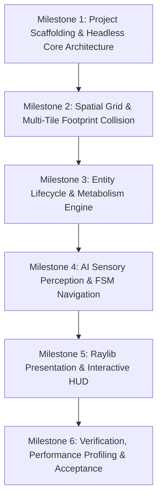

# System Specification & Project Execution Plan
## Autonomous 2D Multi-Tile Organism Simulation (A-Life)

---

## 1. Executive Scope & Non-Goals

### 1.1 Core Mission
Build a deterministic, multi-agent artificial life (A-life) simulation in C++20 and Raylib 5.0. Entities exist on a discrete $100 \times 100$ spatial grid, possessing dynamic multi-tile footprints (from $1 \times 1$ up to $4 \times 4$), metabolic lifecycles (hunger, thirst, calories, aging, damage), olfactory and visual sensing (Chebyshev metric), reproductive inheritance, and priority-driven finite state machines (FSM).

### 1.2 Target User & Operating Environment
- **Operator:** Interactive desktop user (researcher/player) observing simulation dynamics and manually intervening via resource/organism seeding.
- **Platform:** Linux (tested on Arch Linux x86_64; portable across standard GCC 11+ / Clang 14+ toolchains with glibc).
- **Target Frame Rate:** 60 FPS fixed presentation; internal simulation logic decoupled into fixed-timestep updates ($1.0\text{s}$ base tick scaled by factors $1\times, 2\times, 4\times, 8\times$, plus pause/unpause).

### 1.3 Minimum Viable Product (MVP) Scope
1. **Window & Viewport:** $1280 \times 1000$ px desktop window comprising a $1000 \times 1000$ px grid canvas ($10 \times 10$ px per cell) and a $280$ px sidebar HUD.
2. **Deterministic Multi-Tile Grid Engine:** $100 \times 100$ cells with strict multi-tile collision enforcement preventing clipping, cell overlap, or out-of-bounds positioning for footprints $1 \times 1$ through $4 \times 4$.
3. **Entity Lifecycle:**
   - Static Resources: Food ($40$ cal, `0xFFFE`) and Water (`0xFFFF`) with 80 Food and 80 Water placed at initialization, plus continuous periodic spawning ($20\text{s}$–$40\text{s}$).
   - Autonomous Organisms: Dimorphic (Male = Blue hues, Female = Yellow hues; health-modulated shading), sensory scans ($R_{\text{sight}} \in [2, 6]$, $R_{\text{smell}} \in [4, 10]$), metabolic decay ($0.10/\text{s}$ thirst, $0.05/\text{s}$ hunger, $1$ cal/step), starvation damage, aging ($6\text{min}$/yr), growth up to $4 \times 4$, and 90s gestation.
4. **Behavioral Hierarchy (FSM):** Critical thirst/hunger ($\le 3.0$) > Reproduction (both mature `age >= 2`, well-fed $> 6.0$, scent compatibility $\Delta \text{scent} \bmod 10 < 7$) > Wandering with obstacle avoidance.
5. **Manual Controls & Placement Quotas:** Food/Water (unlimited), Male Organisms ($\le 10$), Female Organisms ($\le 10$), speed scaling, pause, and simulation reset (`R`).
6. **Victory/Loss Triggers:** Loss when organism count hits 0; Victory when occupied grid cells reach $\ge 7,500$ ($75\%$).
7. **Modular Headless Library:** Core simulation logic partitioned into a standalone static library (`sim_core`) allowing automated headless test verification without an active graphical display server.
8. **Interactive Hover Inspector:** Dedicated inspection card at the bottom of the sidebar HUD displaying comprehensive real-time stats for the hovered organism (ID, Gender, Size, Life Force, Hunger, Thirst, Calories, Age, Damage, State, and Gestation countdown).
9. **Dual Healing Mechanisms:**
   - Passive Regeneration: Organisms with both hunger and thirst maintained above 50% (`hunger > 5.0` and `thirst > 5.0`) steadily regenerate life force at $1.0/\text{s}$ up to the $100.0$ maximum ceiling.
   - Nutritional Healing: Consuming food restores hunger to $10.0$, adds $40$ calories, and provides an immediate randomized healing burst of $[5.0, 15.0]$ life force (clamped to $100.0$).
10. **Simulation Step Counter Telemetry:**
   - Dedicated counter (`step_count_`, `uint64_t`) tracking cumulative simulation cycles (`Simulation::Step` executions).
   - Formatted and rendered directly below Time Scale in the sidebar HUD (e.g., `Steps: 1,420`).
   - Resets cleanly to 0 upon simulation reset (`R`).
11. **Enhanced Typography & Crisp Font Rendering:**
   - Bundled TrueType font (`assets/fonts/LiberationSans-Regular.ttf` or system path `/usr/share/fonts/liberation/LiberationSans-Regular.ttf`) rendered with bilinear texture filtering (`TEXTURE_FILTER_BILINEAR`) for sharp legibility across all UI labels.
   - Graceful fallback: If TTF file cannot be loaded, automatically falls back to default font without crashing or degradation.
12. **Embedded Window Icon & Cross-Platform Executable Branding:**
   - **Embedded Window Icon:** Converted from `https://sappsworld.com/images/avatar.jpg` into optimized PNG bytes embedded directly into C++ header `include/app/IconData.hpp`. Applied via `LoadImageFromMemory` and `SetWindowIcon` with zero runtime filesystem load requirements.
   - **Cross-Platform Executable Icons:**
     - Linux: Desktop launcher entry `organism_sim.desktop` referencing the application executable and PNG icon.
     - Windows: Multi-size icon `assets/icons/icon.ico` (16, 32, 48, 64, 128, 256 px) and resource script `src/app/resource.rc` embedded into the executable binary via CMake `WIN32` target integration.
13. **Project Usability & Deployment Pipeline (`clean_all`, `rebuild`, `install`):**
   - **Custom Clean Target (`clean_all`):** Executes full target clean across build artifacts.
   - **Clean-Then-Build (`rebuild`):** Executes target clean followed by compilation of both `organism_sim` and `sim_tests`.
   - **Standard Installation Target (`install`):** Uses `GNUInstallDirs` to install the standalone `organism_sim` executable to `bin/`, `organism_sim.desktop` to `share/applications/`, and the application icon to `share/icons/hicolor/200x200/apps/` and `share/pixmaps/`.

### 1.4 Explicit Non-Goals (Out of Scope for v1)
- **No PvP / Carnivore Combat in v1:** Organism `damage` is calculated and reported as an intrinsic attribute based on footprint size $\min(5, \lfloor((W \times H)-1)/3\rfloor)$, but active aggressive predation or combat displacement is out of scope for v1.
- **No Persistent Disk Serialization:** Save/load to JSON or binary files is omitted for v1. State is ephemeral in-memory with keyboard instant-reset (`R`).
- **No Heavy Global Pathfinding:** No full-grid $A^*$ pathfinding graph searches per tick; movement uses greedy Chebyshev descent towards targets with 8-directional fallback collision avoidance.
- **No Audio/SFX Engine:** No sound effects or background music dependencies.

---

## 2. Technical Architecture Specification

### 2.1 System Decomposition & Topology
The codebase follows a modular clean-architecture pattern dividing presentation, core simulation, and automated test runners.

```
organism-sim/
├── CMakeLists.txt              # Top-level build configuration (C++20, Raylib FetchContent)
├── include/
│   ├── sim/
│   │   ├── Common.hpp          # Vector2i, Enums (EntityType, Gender, FSMState), Constants
│   │   ├── GridMatrix.hpp      # 100x100 spatial grid, multi-tile footprint collision & occupancy
│   │   ├── Entity.hpp          # Resource (Food, Water) & Organism struct definitions
│   │   ├── EntityManager.hpp   # Dense contiguous storage, fast lookup, ID allocation
│   │   ├── AIEngine.hpp        # Chebyshev metrics, scent/sight scanning, FSM transition logic
│   │   └── Simulation.hpp      # Step accumulator, timers, lifecycle orchestration, game rules
│   └── app/
│       ├── Renderer.hpp        # Raylib draw procedures (grid, organisms, resources)
│       └── UI.hpp              # HUD sidebar, placement tools, metrics presentation
├── src/
│   ├── sim/                    # Implementation of sim_core (headless)
│   │   ├── GridMatrix.cpp
│   │   ├── EntityManager.cpp
│   │   ├── AIEngine.cpp
│   │   └── Simulation.cpp
│   └── app/                    # Interactive GUI application
│       ├── Renderer.cpp
│       ├── UI.cpp
│       └── main.cpp
└── tests/                      # Headless unit & integration test suites
    ├── test_main.cpp
    ├── test_grid_collision.cpp
    ├── test_metabolism_aging.cpp
    └── test_ai_fsm.cpp
```

### 2.2 Subsystem Interface Contracts

#### A. `GridMatrix` (Spatial Domain)
- **Cell Structure:**
  ```cpp
  struct Cell {
      EntityType type{EntityType::EMPTY};
      uint32_t entity_id{0}; // 0 = None, valid IDs are 1-based
  };
  ```
- **Invariants:**
  - `CanPlace(int x, int y, int w, int h, uint32_t ignore_id = 0) const noexcept -> bool`: Returns `true` iff $[x, x + w - 1] \times [y, y + h - 1]$ is strictly within $[0, 99] \times [0, 99]$ and all covered cells are `EMPTY` or equal to `ignore_id`.
  - `Occupy(int x, int y, int w, int h, EntityType type, uint32_t entity_id) -> void`: Asserts `CanPlace` and fills footprint cells.
  - `Vacate(int x, int y, int w, int h) -> void`: Clears footprint cells back to `EMPTY`.
  - `OccupiedCellCount() const noexcept -> size_t`: Constant-time/accumulated tracking of total occupied cells for victory evaluation ($7,500$ cells).

#### B. `EntityManager` (Data Store)
- Dense contiguous storage (`std::vector<Organism>`, `std::vector<Resource>`) indexed with stable handles/IDs.
- Dead entity pruning uses swap-and-pop or generational indices to prevent invalidation during iteration.

#### C. `AIEngine` (Decision & Spatial Search)
- **Chebyshev Distance:** $D_\infty(A, B) = \max(|A.x - B.x|, |A.y - B.y|)$.
- **Multi-Tile Footprint Distance:** Distance between an organism box $[x_a, x_a + w_a - 1] \times [y_a, y_a + h_a - 1]$ and target box $[x_b, x_b + w_b - 1] \times [y_b, y_b + h_b - 1]$ is defined as:
  $$D_{\text{box}}(A, B) = \max\left(0, \max(x_a - (x_b + w_b - 1), x_b - (x_a + w_a - 1)), \max(y_a - (y_b + h_b - 1), y_b - (y_a + h_a - 1))\right)$$
  Adjacent if and only if $D_{\text{box}}(A, B) \le 1$.
- **Navigation:** Greedy single-step delta $(\operatorname{sgn}(T_x - C_x), \operatorname{sgn}(T_y - C_y))$. If occupied, test immediate adjacent 8-directional neighbors ordered by minimum Chebyshev distance to target. If all blocked, hold position.

#### D. `Simulation` (Orchestrator)
- **Timers:**
  - Resource spawn timer: uniform random $[20.0\text{s}, 40.0\text{s}]$ countdown (proportional to 80-item initial capacity).
  - Initial resources: 80 Food and 80 Water.
  - Gestation timer: $90.0\text{s}$ per pregnant female.
  - Age timer: $360.0\text{s}$ per increment.
  - Base movement tick: $1.0\text{s}$ accumulator (stretched to $2.0\text{s}$ when `calories == 0`).
  - Metabolism tick: $1.0\text{s}$ tick draining thirst by $0.10$ and hunger by $0.05$ (or $0.075$ if calories == 0). Starvation/dehydration deals $2.0/\text{s}$ damage when either stat is $\le 0.0$.
  - Passive Healing: If `hunger > 5.0` and `thirst > 5.0`, life force regenerates by $+1.0/\text{s}$ (up to $100.0$).
  - Food Consumption: Restores hunger to $10.0$, adds $40$ calories, and heals $+[5.0, 15.0]$ life force (up to $100.0$).

#### E. `Renderer` & `UI` (Presentation)
- Playfield: $1000 \times 1000$ pixels ($10$ pixels/cell).
- Dynamic Organism Coloring:
  - Base male color: `BLUE` (RGB: 50, 120, 220); Base female color: `YELLOW` (RGB: 230, 200, 40).
  - Shading modulated by `life_force / 100.0f` (darkening/desaturating towards near-black/gray when dying).
  - Food: Green square ($10 \times 10$). Water: Cyan/Deep Blue square ($10 \times 10$).
- Sidebar HUD ($280 \times 1000$):
  - Simulation state: Paused / Running, Speed multiplier ($1\times, 2\times, 4\times, 8\times$).
  - Grid occupancy: Total cells covered, % of $10,000$ (target $\ge 75\%$, counting organism cells only).
  - Demographics: Total organisms, Male count, Female count, Average age, Gestating females.
  - Manual placement counters: Male ($N/10$), Female ($N/10$), Food (unlimited), Water (unlimited).
  - Selected tool indicator and victory/loss banners.
  - Bottom Inspection Card: Real-time telemetry for the organism hovered by mouse cursor in the playfield. Displays: ID, Gender, Size ($W \times H$), Health/Life-Force, Hunger ($/10.0$), Thirst ($/10.0$), Calories & Lifetime Calories, Age ($/100$), Damage rating ($0-5$), Active FSM Behavior State, and Gestation timer ($N\text{s}$). Displays placeholder hint when idle.

---

## 3. Work Breakdown Structure (WBS)



### Milestone 1: Project Scaffolding & Headless Core Architecture
- [ ] Configure `CMakeLists.txt` with C++20, static Raylib 5.0 FetchContent, compiler warning flags (`-Wall -Wextra -pedantic`).
- [ ] Structure CMake targets: static library `organism_sim_core`, test runner `sim_tests`, and application `organism_sim_gui`.
- [ ] Define core data types, math structs (`Vector2i`), entity descriptors, and fixed-point/float constants in `Common.hpp`.

### Milestone 2: Spatial Grid & Multi-Tile Footprint Collision
- [ ] Implement `GridMatrix` with flat 10,000-element array.
- [ ] Implement robust multi-tile box collision verification (`CanPlace`, `Occupy`, `Vacate`, `CanMove`).
- [ ] Implement multi-tile growth allocation logic (expanding $W$ or $H$ up to $4 \times 4$ without overlaps or out-of-bounds).
- [ ] Create headless unit test suite verifying footprint collisions, boundary limits, and overlap prevention.

### Milestone 3: Entity Lifecycle & Metabolism Engine
- [ ] Implement `EntityManager` with dense storage and ID generation.
- [ ] Implement metabolism ticks: hunger/thirst depletion, calorie expenditure per step, starvation damage ($2.0$ life force/s).
- [ ] Implement aging timer ($360\text{s}$ per age increment) and death cleanup (life force $\le 0$).
- [ ] Implement resource spawning timer (uniform random $[60\text{s}, 120\text{s}]$) and resource consumption effects.
- [ ] Write unit tests for metabolic exhaustion, calorie halving, and resource replenishing.

### Milestone 4: AI Sensory Perception & FSM Navigation
- [ ] Implement Chebyshev metric calculations and box-to-box distance for multi-tile footprints.
- [ ] Implement scent and sight range scanning algorithms ($R_{\text{sight}} \in [2, 6]$, $R_{\text{smell}} \in [4, 10]$).
- [ ] Implement priority FSM transitions: Critical need > Mating > Random wander.
- [ ] Implement reproduction logic: scent compatibility check ($\Delta \text{scent} \bmod 10 < 7$), $90\text{s}$ gestation, offspring trait inheritance.
- [ ] Implement greedy movement step with obstacle collision fallback.
- [ ] Write integration tests simulating starvation-seeking behavior and reproduction spawning.

### Milestone 5: Raylib Presentation & Interactive HUD
- [ ] Implement `Renderer` drawing the $100 \times 100$ playfield with gridlines, resource tiles, and multi-tile organisms.
- [ ] Implement color shading based on gender and health/life-force.
- [ ] Implement right-hand sidebar HUD displaying simulation statistics, tool selector, and status banners.
- [ ] Wire mouse input for placing entities (enforcing 10 Male, 10 Female limits).
- [ ] Wire keyboard shortcuts: `1`, `2`, `3`, `4` (tool selection), `Space` (pause), `+`/`-` (speed), `R` (reset).

### Milestone 6: Verification, Performance Profiling & Acceptance
- [ ] Verify victory trigger ($\ge 7,500$ cells) and loss trigger ($0$ organisms).
- [ ] Conduct stress tests with high organism densities (up to $2,000+$ organisms) to verify 60 FPS stability.
- [ ] Verify zero memory leaks or address sanitization errors using ASan/UBSan builds.

---

## 4. Risk Matrix & Mitigations

| Risk Description | Severity | Likelihood | Mitigation Strategy |
| :--- | :---: | :---: | :--- |
| **Multi-tile growth cell thrashing:** An expanding organism partially overwriting its own cells during in-place expansion check. | High | Med | In `CanExpand`, temporarily treat the entity's current cells as valid/passable, checking only the newly appended boundary slice. |
| **Grid fragmentation deadlock:** High density of organisms blocking mates or resources completely, causing starvation clusters. | Med | High | Greedy step checks 8-directional fallback paths. If completely surrounded, entities hold position without burning movement calories. |
| **Raylib headless testing failure:** Raylib initializing an X11/Wayland context during automated CLI test runs on headless servers. | High | Low | Decouple `sim_core` as a purely headless static library with zero Raylib includes. All automated tests link exclusively to `sim_core`. |
| **Offspring spawn blockage:** Female completes $90\text{s}$ gestation but all 8 adjacent tiles are occupied by entities or walls. | Med | Med | Defer birth check each tick until an adjacent $1 \times 1$ empty cell becomes available, preserving gestated state without resetting the full timer. |
| **Frame-rate dependent simulation:** Higher or fluctuating frame rates causing faster or erratic simulation ticks. | High | Low | Implement a fixed-timestep simulation accumulator (`accumulated_time += dt`). The simulation only ticks in discrete delta slices. |

---

## 5. Phase 1 Execution Checklist

- [ ] **Step 1.1:** Scaffold project directory structure (`include/`, `src/`, `tests/`, `.planning/`).
- [ ] **Step 1.2:** Write root `CMakeLists.txt` fetching Raylib 5.0, declaring `-std=c++20`, and configuring targets (`sim_core`, `sim_tests`, `organism_sim`).
- [ ] **Step 1.3:** Implement `include/sim/Common.hpp` with fundamental constants, coordinate types, and enumerations.
- [ ] **Step 1.4:** Implement `GridMatrix` (`include/sim/GridMatrix.hpp` and `src/sim/GridMatrix.cpp`) with full bounding-box collision verification.
- [ ] **Step 1.5:** Implement unit test suite `tests/test_grid_collision.cpp` to validate spatial boundary rules before building higher-level systems.

---

*Pipeline Citation:*
Following the Engineering Lifecycle Workflow, the next logical skill to execute is **`test-matrix-designer`** (to construct the comprehensive verification architecture, boundary cases, and test scenarios prior to code implementation) or **`architecture-spikes`** (if prototyping Raylib `FetchContent` compilation times or multi-tile collision algorithms).

