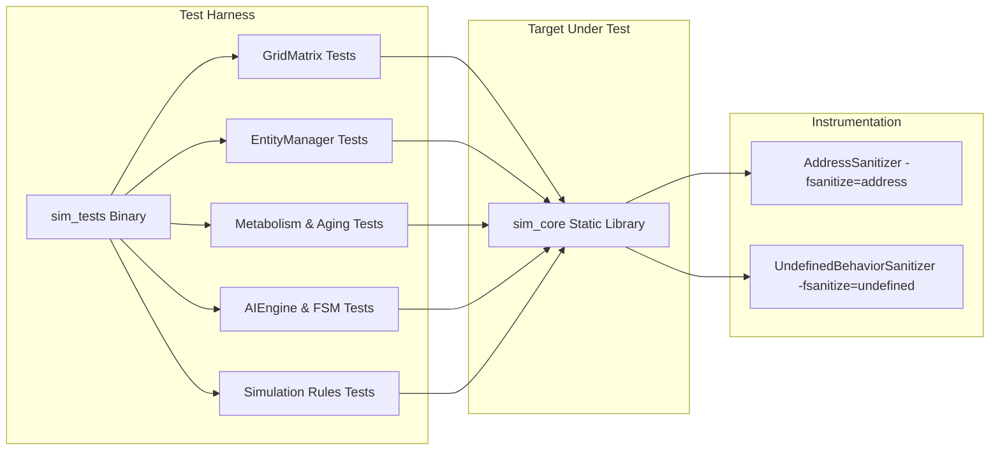

# Test Matrix & Verification Architecture
## Autonomous 2D Multi-Tile Organism Simulation (A-Life)

- **Document ID:** VERIFY-01
- **File Target:** `.planning/03-test-matrix.md`
- **Standard:** Deterministic, Hermetic, Memory-Safe C++20 Verification

---

## 1. Verification Architecture & Testing Strategy

The test architecture leverages a headless test runner (`sim_tests`) compiled against `sim_core`. This guarantees 100% test reproducibility in automated environments without requiring an active X11/Wayland display server or GPU context.



### Four Pillars of Verification:
1. **Zero Flakiness / Mocked Timers:** The simulation updates using discrete delta-time slices (`SimulateTick(float dt)`). Tests pass explicit deterministic timestamps rather than relying on `std::this_thread::sleep_for`.
2. **PRNG Determinism:** `AIEngine` and `Simulation` accept explicit pseudorandom generator seeds (or deterministic RNG wrappers) to guarantee 100% reproducible test trajectories.
3. **Memory Safety Enforcement:** All test targets must compile cleanly with `-fsanitize=address,undefined` with zero memory leaks, buffer overruns, or alignment violations.
4. **Boundary Isolation:** Spatial checks, metabolic rates, and FSM decisions are verified via isolated unit test fixtures before full simulation loop integration.

---

## 2. Input Boundary & Contract Matrix

### Suite A: `GridMatrix` (Spatial Domain & Multi-Tile Collisions)

| Test ID | Test Category | Input Vector / State | Expected Output / Contract Invariant |
| :--- | :--- | :--- | :--- |
| **TC-GRID-01** | Happy Path | Place $1 \times 1$ entity at $(50, 50)$ | Returns `true`; `grid[50][50]` matches entity ID/type; `OccupiedCellCount() == 1`. |
| **TC-GRID-02** | Happy Path | Place $4 \times 4$ entity at $(10, 10)$ | Returns `true`; all 16 cells $[10..13] \times [10..13]$ occupied; `OccupiedCellCount() == 16`. |
| **TC-GRID-03** | Boundary (Corner) | Place $4 \times 4$ entity at $(96, 96)$ (maximum valid bounds) | Returns `true`; cells $[96..99] \times [96..99]$ occupied; no out-of-bounds assertion. |
| **TC-GRID-04** | Boundary (OOB X) | Attempt placing $4 \times 4$ at $(97, 10)$ | Returns `false`; zero grid cells modified; `OccupiedCellCount()` unchanged. |
| **TC-GRID-05** | Boundary (OOB Y) | Attempt placing $4 \times 4$ at $(10, 97)$ | Returns `false`; zero grid cells modified. |
| **TC-GRID-06** | Boundary (Negative) | Attempt placing $1 \times 1$ at $(-1, 0)$ or $(0, -1)$ | Returns `false`; rejection without memory segfault. |
| **TC-GRID-07** | Collision Overlap | Place $2 \times 2$ at $(20, 20)$; attempt placing $2 \times 2$ at $(21, 21)$ | Returns `false`; second entity placement rejected; initial cells preserved. |
| **TC-GRID-08** | In-Place Vacate | Vacate $3 \times 3$ footprint at $(30, 30)$ | All 9 cells reset to `EMPTY` and ID 0; `OccupiedCellCount()` decrements by 9. |
| **TC-GRID-09** | Growth Expansion | $2 \times 2$ at $(40, 40)$ attempts growth to $3 \times 2$ (adding column $x=42$) | `CanExpand` validates new cells are empty; in-place expansion succeeds; cell count increments by 2. |
| **TC-GRID-10** | Growth Collision | $2 \times 2$ at $(40, 40)$ attempts growth to $3 \times 2$, but cell $(42, 40)$ has Food | Expansion returns `false`; footprint remains $2 \times 2$; Food cell undisturbed. |

---

### Suite B: `Metabolism` & Lifecycle Engine

| Test ID | Test Category | Input Vector / State | Expected Output / Contract Invariant |
| :--- | :--- | :--- | :--- |
| **TC-MET-01** | Thirst Depletion | Organism with `thirst = 10.0`, tick $1.0\text{s}$ | `thirst` equals $9.90 \pm 0.001$. |
| **TC-MET-02** | Hunger Depletion | Organism with `hunger = 10.0`, tick $1.0\text{s}$ | `hunger` equals $9.95 \pm 0.001$. |
| **TC-MET-03** | Movement Calorie Drain | Organism with $50$ calories takes 1 step | `calories` becomes $49$. |
| **TC-MET-04** | Exhaustion Penalties | Organism with `calories = 0` | Speed halved ($0.5\times$); hunger drain rate multiplied by $1.5\times$ ($0.075/\text{s}$). |
| **TC-MET-05** | Starvation Damage | Organism with `hunger = 0.0`, `life_force = 100.0`, tick $1.0\text{s}$ | `life_force` drops to $98.0$. |
| **TC-MET-06** | Dehydration Damage | Organism with `thirst = 0.0`, `life_force = 100.0`, tick $1.0\text{s}$ | `life_force` drops to $98.0$. |
| **TC-MET-07** | Simultaneous Drain | Organism with `hunger = 0.0` AND `thirst = 0.0`, tick $1.0\text{s}$ | `life_force` drops to $98.0$ (or additive depending on spec: life_force -= 2.0f if either <= 0). |
| **TC-MET-08** | Mortality & Despawn | Organism with `life_force = 1.0` takes $2.0$ damage | `life_force <= 0.0`; organism marked dead; grid cells vacated on next cleanup. |
| **TC-MET-09** | Aging Transition | Organism alive for $360.0\text{s}$ simulation time | `age` increments from $1$ to $2$. |
| **TC-MET-10** | Food Ingestion | Organism consumes Food ($40$ cal) | `hunger` restored to $10.0$; `calories += 40`; Food entity removed from grid. |
| **TC-MET-11** | Water Ingestion | Organism consumes Water | `thirst` restored to $10.0$; Water entity removed from grid. |
| **TC-MET-12** | Passive Healing (Active) | Organism with `hunger = 8.0, thirst = 8.0, life_force = 50.0`, tick $1.0\text{s}$ | `life_force` regenerates to $51.0 \pm 0.01$. |
| **TC-MET-13** | Passive Healing (Threshold) | Organism with `hunger = 5.0, thirst = 8.0, life_force = 50.0`, tick $1.0\text{s}$ | Zero regeneration; `life_force` remains $50.0$ (requires strictly $> 5.0$). |
| **TC-MET-14** | Passive Healing (Max Clamp) | Organism with `hunger = 8.0, thirst = 8.0, life_force = 99.5`, tick $1.0\text{s}$ | `life_force` clamped to maximum $100.0$; zero overflow. |
| **TC-MET-15** | Nutritional Food Healing | Organism with `life_force = 50.0` consumes Food | `life_force` increases by $[5.0, 15.0]$ (resulting in $[55.0, 65.0]$); `hunger = 10.0`. |
| **TC-MET-16** | Food Healing Max Clamp | Organism with `life_force = 98.0` consumes Food | `life_force` clamped to maximum $100.0$. |

---

### Suite C: `AIEngine` (Sensory & Priority FSM)

| Test ID | Test Category | Input Vector / State | Expected Output / Contract Invariant |
| :--- | :--- | :--- | :--- |
| **TC-AI-01** | Chebyshev Distance | Box A $(10, 10, 2, 2)$, Box B $(14, 10, 1, 1)$ | Chebyshev distance $= 14 - (10 + 2 - 1) = 3$. |
| **TC-AI-02** | Multi-Tile Adjacency | Box A $(10, 10, 2, 2)$, Box B $(12, 11, 1, 1)$ | $D_{\text{Chebyshev}} = 1$ (adjacent); can consume or mate without overlapping. |
| **TC-AI-03** | Priority: Need > Mate | Organism with `thirst = 2.5` (critical) next to eligible mate | FSM selects `CRITICAL_NEED` targeting water; does not initiate mating. |
| **TC-AI-04** | Reproduction Check | Male & Female adjacent, `hunger > 6`, `thirst > 6`, `age >= 2` | Compatibility check: `abs(scent_a - scent_b) % 10 < 7`. If true, female enters gestation ($90\text{s}$). |
| **TC-AI-05** | Incompatible Scent | Scent diff has `diff % 10 == 8` | Mating rejected; organisms do not enter gestation. |
| **TC-AI-06** | Gestation & Offspring | Gestation timer reaches $0.0\text{s}$ | Searches 8 adjacent cells; spawns $1 \times 1$ child; clamps traits ($S \in [2,6]$, $M \in [4,10]$). |
| **TC-AI-07** | Gestation Blocked | Gestation reaches $0.0\text{s}$, but all 8 adjacent cells blocked | Does not drop pregnancy or crash; retries birth on subsequent tick. |
| **TC-AI-08** | Wander Fallback | Organism has no sight/smell targets | Selects random adjacent cell; if blocked, tests alternative 7 directions. |

---

### Suite D: Game Loop, Win/Loss, Quotas & 80-Resource Baseline

| Test ID | Test Category | Input Vector / State | Expected Output / Contract Invariant |
| :--- | :--- | :--- | :--- |
| **TC-RULE-01** | Placement Quota Male | Place 10 males manually, then attempt 11th | 11th placement rejected; counter stays at $10/10$. |
| **TC-RULE-02** | Placement Quota Female | Place 10 females manually, then attempt 11th | 11th placement rejected; counter stays at $10/10$. |
| **TC-RULE-03** | Food/Water Unlimited | Place 50 Food and 50 Water items | All 100 placements accepted provided cells are empty. |
| **TC-RULE-04** | Resource Spawn Interval | Timer counts down from $T \in [20, 40]$ | Spawns exactly 1 Food or Water at an empty cell; resets timer to new $T \in [20, 40]$. |
| **TC-RULE-05** | Victory Trigger | Organism footprints occupy $7,500$ cells | `CheckGameStatus()` returns `VICTORY`. |
| **TC-RULE-06** | Loss Trigger | All organisms die (`organism_count == 0`) | `CheckGameStatus()` returns `DEFEAT`. |
| **TC-RULE-07** | Reset Operation | Call `Reset()` during active game | Grid cleared; quotas reset; 1 Male, 1 Female, 80 Food, 80 Water re-seeded. |
| **TC-RULE-08** | Occupancy Organism Filter | Place resources and organisms | Grid occupancy counts ONLY organism cells; food/water ignored. |
| **TC-RULE-09** | 80 Resource Capacity | Fresh initialization or reset | Exactly 80 Food and 80 Water instances active; zero overlap. |

---

### Suite E: Organism Hover Inspection Engine

| Test ID | Test Category | Input Vector / State | Expected Output / Contract Invariant |
| :--- | :--- | :--- | :--- |
| **TC-INSP-01** | Empty Cell Hover | Inspect cell coordinate with `EMPTY` | Returns `nullptr`; no hover data displayed. |
| **TC-INSP-02** | Resource Cell Hover | Inspect coordinate with `FOOD` or `WATER` | Returns `nullptr` (inspector targets organisms exclusively). |
| **TC-INSP-03** | Single-Tile Organism | Inspect coordinate of active $1 \times 1$ organism | Returns non-null `Organism*`; ID and attributes match entity. |
| **TC-INSP-04** | Multi-Tile Footprint | Inspect all 16 coordinates of $4 \times 4$ organism | Every coordinate in $[x..x+3] \times [y..y+3]$ resolves to the same organism ID. |
| **TC-INSP-05** | Boundary Coordinates | Inspect $(-1, 50)$ or $(100, 50)$ | Returns `nullptr` safely without memory violation. |

---

### Suite F: Step Counter Telemetry & Font Graceful Fallback

| Test ID | Test Category | Input Vector / State | Expected Output / Contract Invariant |
| :--- | :--- | :--- | :--- |
| **TC-STEP-01** | Initial Step Count | Fresh `Simulation` instantiation | `sim.GetStepCount() == 0`. |
| **TC-STEP-02** | Incremental Steps | Call `sim.Step(1.0f)` $25$ consecutive times | `sim.GetStepCount() == 25`. |
| **TC-STEP-03** | Reset Invariant | Call `sim.Step(1.0f)` 10 times, then `sim.Reset()` | `sim.GetStepCount() == 0`. |
| **TC-STEP-04** | Variable Timestep Invariance | Call `sim.Step(0.016f)`, `sim.Step(0.5f)`, `sim.Step(2.0f)` | Each call increments `step_count_` by exactly $1$; step count equals 3. |
| **TC-FONT-01** | Font Fallback Safety | Request font load with invalid path | Returns false or falls back to default font cleanly without crash or leak. |

---

### Suite G: Embedded Icon & Executable Branding Contracts

| Test ID | Test Category | Input Vector / State | Expected Output / Contract Invariant |
| :--- | :--- | :--- | :--- |
| **TC-ICON-01** | Embedded PNG Magic Bytes | Inspect `ICON_PNG_DATA` in memory | Array non-empty; first 8 bytes match PNG header `\x89PNG\r\n\x1a\n`. |
| **TC-ICON-02** | Icon Byte Array Length | Inspect `ICON_PNG_DATA_LEN` | Greater than 1,000 bytes; matches static array sizeof. |
| **TC-ICON-03** | Windows ICO Asset | Inspect `assets/icons/icon.ico` binary | First 4 bytes match ICO signature `0x00 0x00 0x01 0x00`. |
| **TC-ICON-04** | Desktop Launcher Spec | Inspect `organism_sim.desktop` | Valid FreeDesktop INI format with `Name`, `Exec`, `Icon`, and `Type=Application`. |

---

### Suite H: Build Automation & Installation Deployment Pipeline

| Test ID | Test Category | Input Vector / State | Expected Output / Contract Invariant |
| :--- | :--- | :--- | :--- |
| **TC-BUILD-01** | Custom Clean Target | `cmake --build build --target clean_all` | Exits with status 0; invokes underlying clean target. |
| **TC-BUILD-02** | Clean Then Build Target | `cmake --build build --target rebuild` | Cleans and compiles both `organism_sim` and `sim_tests` with 0 warnings. |
| **TC-BUILD-03** | Staged Binary Installation | `cmake --install build --prefix /tmp/organism_sim_test_install` | Installs `bin/organism_sim`, `share/applications/organism_sim.desktop`, `share/icons/hicolor/200x200/apps/organism_sim.png`, and `share/pixmaps/organism_sim.png`. |

---

## 3. Adverse & Fault Injection Scenarios

### Scenario 1: Total Grid Saturation During Spawning
- **Trigger:** Fill $9,999$ of $10,000$ cells; trigger continuous resource spawning.
- **Assertion:** System scans for remaining empty cell without entering an infinite loop. When 0 cells remain, resource spawn is dropped safely without crash.

### Scenario 2: Swarm Bottleneck Deadlock
- **Trigger:** Cluster 15 organisms in a $5 \times 5$ cul-de-sac with food located outside.
- **Assertion:** Pathfinding handles blocked steps gracefully, holding position without consuming step calories or crashing from failed moves.

### Scenario 3: Despawn During Iteration
- **Trigger:** Organism A consumes food while Organism B dies of starvation within the same simulation tick.
- **Assertion:** Entity iteration using stable IDs/indices does not cause invalid iterator dereference or double-free errors.

---

## 4. Compiler, Toolchain & Sanitizer Matrix

| Environment | Compiler / Toolchain | Target Arch | Required Build & Sanitizer Configuration |
| :--- | :--- | :--- | :--- |
| **Linux (Primary / Arch)** | GCC 16.2.1 | x86_64 | `-std=c++20 -Wall -Wextra -pedantic -fsanitize=address,undefined` |
| **Linux (Secondary / Clang)** | Clang 23.1.4 | x86_64 | `-std=c++20 -Wall -Wextra -pedantic -fsanitize=address,undefined` |
| **Release Build** | GCC / Clang | x86_64 | `-O3 -DNDEBUG` (validates performance target > 60 FPS at full load) |

---

## 5. Verification Commands

```bash
# 1. Configure and build test runner with AddressSanitizer and UndefinedBehaviorSanitizer
cmake -B build -DCMAKE_BUILD_TYPE=Debug -DENABLE_SANITIZERS=ON
cmake --build build --target sim_tests

# 2. Execute full automated headless test suite
./build/tests/sim_tests --verbose

# 3. Release benchmark / 60 FPS load validation
cmake -B build_release -DCMAKE_BUILD_TYPE=Release
cmake --build build_release
./build_release/organism_sim --headless-stress-test
```

